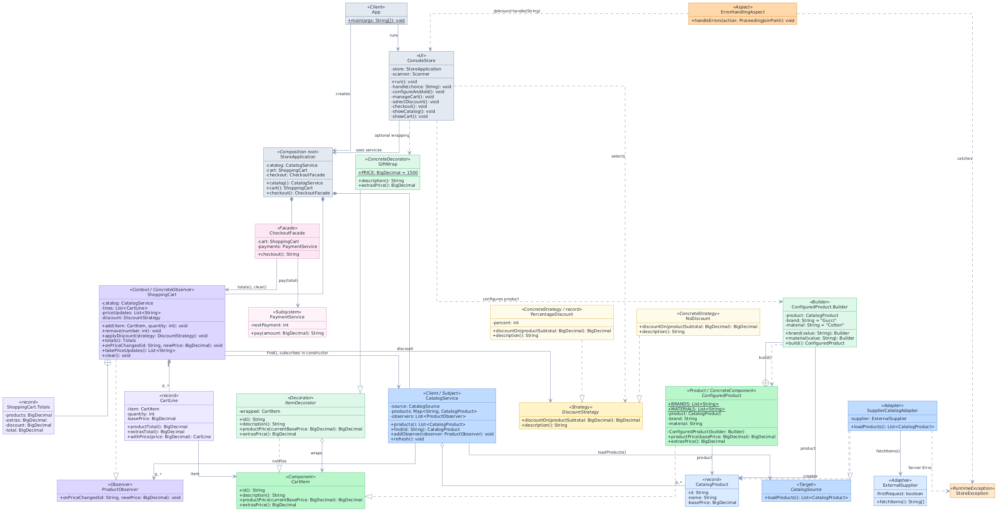

# sdp-final

* E-Commerce Shopping Cart - a clothing store written in Java 21, with a console and a JavaFX gui.
* Final project for the "Software Design Patterns" course, Astana IT University, SE-2539.

## Team

| Member | GitHub | Patterns |
|---|---|---|
| Alzhan Kainazarov | kc8, satiristica | Strategy, Facade |
| Daniyar Topaev | Daniyar-techit | Builder, Decorator |
| Azimbek Amandykov | Azimbek | Adapter, Observer |

## Features

- Browse the catalog loaded from an external supplier
- Customise a product (brand and material)
- Add gift wrapping
- Manage the cart and remove items
- Apply a discount
- Refresh supplier prices; the cart updates automatically
- Checkout with a simulated payment
- Completed orders are saved in a SQLite database
- Two interfaces: a console menu and a JavaFX window with a live price preview

## Run

Run commands from the ShoppingCart directory.

```
cd ShoppingCart
./gradlew run --console=plain   # TUI 
./gradlew gui                   # GUI
./gradlew demo                  # checkout without the facade, for comparison
./gradlew test                  # junit tests
```

The coverage report is created in `app/build/reports/jacoco/test/html/index.html`. The JavaFX window (`StoreWindow`, `GuiLauncher`) is excluded because it is tested manually; the console interface, which uses the same `StoreApplication` methods, is covered by tests.

## Design patterns

| Pattern | Classes | Purpose |
|---|---|---|
| Strategy | `DiscountStrategy`, `NoDiscount`, `PercentageDiscount` | Change the discount at runtime |
| Facade | `CheckoutFacade`, `PaymentService`, `OrderRepository` | Validate, pay, save the order and clear the cart in one call |
| Builder | `ConfiguredProduct.Builder` | Create a product with a brand and material |
| Decorator | `ItemDecorator`, `GiftWrap` | Add gift wrapping to any cart item |
| Adapter | `SupplierCatalogAdapter`, `ExternalSupplier` | Convert supplier text rows into catalog products |
| Observer | `CatalogService`, `ProductObserver`, `ShoppingCart` | Update cart prices when the supplier changes them |

`StoreApplication` creates and connects all services. Both interfaces (`ConsoleStore` and `StoreWindow`) talk only to `StoreApplication`, never to the cart, catalog or checkout directly.

Errors are reported as a `StoreException` ("Client Error" or "Server Error"). In the console they are handled in one place by an AspectJ aspect (`ErrorHandlingAspect`) around `ConsoleStore.handle(String)`; the window shows them in a dialog.

## Database

Every successful checkout is saved by `OrderRepository` (JDBC) into the `orders` table of a SQLite file:

| Column | Example |
|---|---|
| `id` | `1` (generated, unique) |
| `payment_reference` | `PAY-1` |
| `total` | `44700.00` |
| `created_at` | `2026-11-14T15:02:11` |

The file is created automatically at `ShoppingCart/app/store.db` and is not committed. To see the saved orders:

```
sqlite3 app/store.db "SELECT * FROM orders;"
```

Tests use an in-memory database, so they never touch this file.

## UML diagram



## Tech stack

Java 21, Gradle (Kotlin DSL), JavaFX 21, SQLite (JDBC), AspectJ, JUnit 6, JaCoCo.
